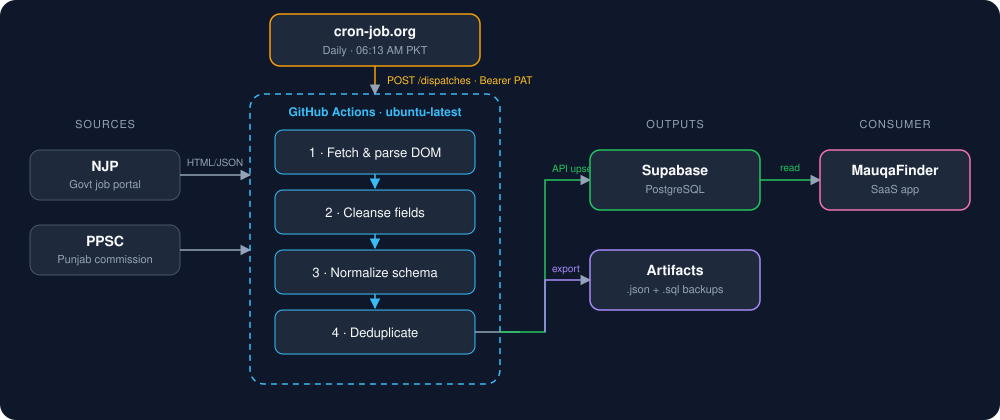

# 🕵️‍♂️ MauqaFinder: Automated Government Job Ingestion Pipeline


**MauqaFinder** is an automated ETL pipeline that scrapes, cleanses, and consolidates government job postings from fragmented public portals in Pakistan (**NJP**, **PPSC**) into one clean, queryable dataset.

This repository holds the extraction logic and the scheduling workflow. It is the data-feeding engine for the [MauqaFinder SaaS App](https://github.com/hasaan1315/MauqaFinder-app).

---

## 📑 Table of Contents

- [Pipeline Architecture](#️-pipeline-architecture)
- [Key Engineering Features](#-key-engineering-features)
- [Tech Stack](#-tech-stack)
- [Workflow Execution](#️-workflow-execution)
- [External Trigger Setup](#-external-trigger-setup)
- [Local Development](#-local-development)
- [Output Artifacts](#-output-artifacts)
- [Roadmap](#-roadmap)

---

## 🏗️ Pipeline Architecture



**Flow in one line:** `cron-job.org` fires a `workflow_dispatch` → GitHub Actions spins up a runner → the scraper fetches NJP and PPSC → data is cleansed, normalized, and deduplicated → results are upserted to Supabase and exported as `.json` / `.sql` artifacts → the SaaS app reads from Supabase.

---

## 🚀 Key Engineering Features

| Feature | What it does |
|---|---|
| **Idempotent extraction** | Scrapers parse complex DOM structures. Duplicate postings are normalized and removed before insertion, so re-runs never create duplicate rows. |
| **Guaranteed schedule (external trigger)** | GitHub's shared `cron` queue can delay runs by many minutes. An external scheduler calls the `workflow_dispatch` API with a fine-grained PAT, so the job starts at **06:13 AM PKT** reliably. |
| **Automated artifacts** | Raw HTML is transformed into structured `.json` and `.sql` files for auditing and backup. |
| **Zero-server ops** | No VM to maintain. The whole pipeline runs on an ephemeral `ubuntu-latest` runner. |

---

## 🧰 Tech Stack

| Layer | Tools |
|---|---|
| Language | Python 3.9+ |
| Extraction | HTTP requests + HTML/JSON parsing |
| Orchestration | GitHub Actions (`workflow_dispatch`) |
| Scheduler | cron-job.org |
| Storage | Supabase (PostgreSQL), JSON / SQL artifacts |

---

## ⚙️ Workflow Execution

Defined in `.github/workflows/scraper_cron.yml`. On each trigger the runner:

1. Starts an `ubuntu-latest` machine
2. Checks out the repository
3. Installs Python dependencies from `requirements.txt`
4. Runs the scraper (`main_scraper.py`)
5. Upserts cleaned records into the backend database
6. Saves `.json` and `.sql` artifacts

---

## ⏰ External Trigger Setup

Create a job on [cron-job.org](https://cron-job.org) with these settings:

- **URL:** `https://api.github.com/repos/hasaan1315/MauqaFinder/actions/workflows/scraper_cron.yml/dispatches`
- **Method:** `POST`
- **Schedule:** daily at `06:13` (Asia/Karachi)
- **Headers:**
  ```
  Accept: application/vnd.github+json
  Authorization: Bearer <YOUR_FINE_GRAINED_PAT>
  X-GitHub-Api-Version: 2022-11-28
  ```
- **Body:**
  ```json
  { "ref": "main" }
  ```

> **PAT permissions:** a fine-grained token scoped to this repository only, with **Actions: Read and write**. Never commit the token. Store it only inside cron-job.org.

The workflow file must include the trigger:

```yaml
on:
  workflow_dispatch:
```

---

## 💻 Local Development

**1. Clone the repository**

```bash
git clone https://github.com/hasaan1315/MauqaFinder.git
cd MauqaFinder
```

**2. Create a virtual environment (recommended)**

```bash
python -m venv venv
source venv/bin/activate      # Windows: venv\Scripts\activate
```

**3. Install dependencies**

```bash
pip install -r requirements.txt
```

**4. Set environment variables**

Create a `.env` file (never commit it). Adjust names to match your code:

```env
SUPABASE_URL=https://your-project.supabase.co
SUPABASE_KEY=your-service-role-key
```

**5. Run the pipeline**

```bash
python main_scraper.py
```

---

## 📦 Output Artifacts

| File | Purpose |
|---|---|
| `*.json` | Structured job records for auditing and reuse |
| `*.sql` | Insert/upsert statements for backup and replay |

---

## 🗺️ Roadmap

- [ ] Add more portals and department websites
- [ ] Retry with backoff and failure alerts (email / Telegram)
- [ ] Data-quality checks before upsert
- [ ] Expired-job detection and archiving

---

## 🤝 Related

- 🖥️ **App:** [MauqaFinder-app](https://github.com/hasaan1315/MauqaFinder-app)

## 👤 Author

**Hasaan** — Data Engineer · [GitHub](https://github.com/hasaan1315)
